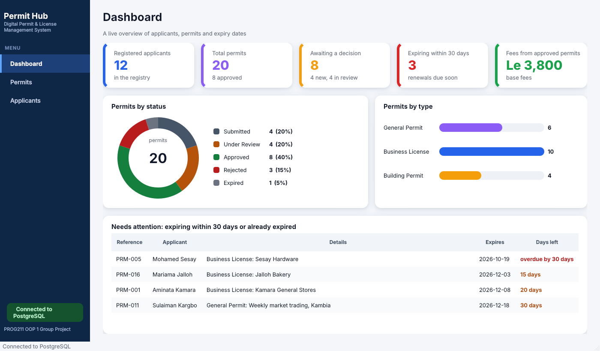
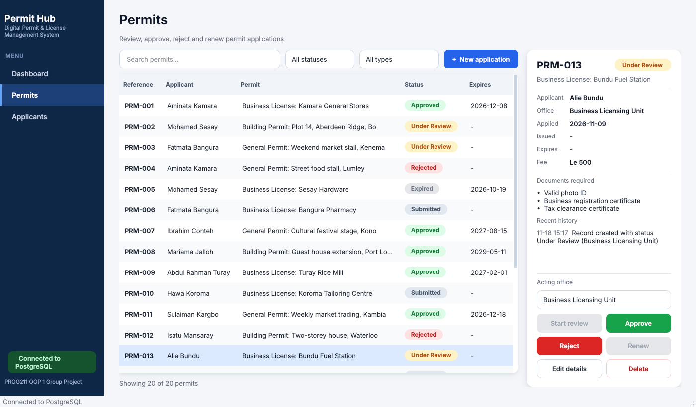

# Digital Permit & License Management System

PROG211 Object-Oriented Programming 1 group project (Limkokwing University of
Creative Technology, Sierra Leone). A Python OOP application with a **PyQt6**
interface and a **PostgreSQL** database. Citizens register once, apply for
business licences, building permits and general permits, and licensing offices
review, approve, reject and renew them. Approved permits that pass their expiry
date are marked **Expired** automatically.





## Digital Public Goods (DPG) alignment

| DPG standard | How this project meets it |
|---|---|
| Open source | All code is in this repository under the MIT licence (`LICENSE`). |
| Privacy and data minimisation | Only a name, phone number and district are stored. There is no column for a national ID number, address or photo (`db/sql/01_tables.sql`). Phone numbers and names are validated before saving. |
| Do no harm | Status changes follow a fixed set of allowed paths (`TRANSITIONS`), so a rejected permit cannot be quietly approved. An office can only act on the permit types it is responsible for. Deleting needs confirmation, and an applicant who still has permits cannot be deleted. |
| Relevance to the SDGs | SDG 16 (transparent, accountable institutions) and SDG 8 (decent work: easier business registration). |
| Platform independence and reuse | Standard Python and PostgreSQL only. Districts, fees and permit types are data in the code and database, so another country can change them. |
| Documentation | This README, docstrings in every module, the SQL scripts in `db/`, `tests.py` and the group reports. |

## Requirements
- Python 3.10 or newer
- PostgreSQL 14 or newer
- `pip install -r requirements.txt`

## Setup
```bash
createdb permits_db                 # or: psql -U postgres -c "CREATE DATABASE permits_db"

# Linux / macOS
export PGUSER=postgres PGPASSWORD=your_password
# Windows (PowerShell)
$env:PGUSER="postgres"; $env:PGPASSWORD="your_password"

python main.py                      # tables, functions, triggers and views are created automatically (db/sql)
```
Optional variables: `PGHOST`, `PGPORT`, `PGDATABASE`. Passwords are never stored in the code.
If the database is unreachable the app offers **offline mode** (memory only) for demos.

Optional demo data (fictional people): `psql -U postgres -d permits_db -f db/sql/07_sample_data.sql`

## Example usage

| Step | Input | Output |
|---|---|---|
| 1. Applicants tab | Name `Ibrahim Conteh`, phone `+232 79 456789`, district `Kono`, press **Register new applicant** | Row `APP-004` appears; status bar: *Registered Ibrahim Conteh as APP-004.* |
| 2. Permits tab | Applicant `APP-003`, type `Business License`, business name `Bangura Pharmacy`, press **Submit application** | Message: *Your permit reference is: PRM-006. Fee to pay: Le 500.* |
| 3. Choose office `Business Licensing Unit`, select `PRM-006`, press **Start review** | | Status becomes *Under Review* |
| 4. Press **Approve** | | Status *Approved*, expiry date set one year ahead |
| 5. Select an *Expired* permit, press **Renew** | | Status *Approved*, new expiry date |
| 6. Wrong office (e.g. Building Control Unit on a business permit) | | Warning: *Building Control Unit does not handle Business Licenses.* |
| 7. Phone `123` | | Warning: *Phone number must have 8 to 12 digits.* |
| 8. **History** | | Time-stamped list of every change, read from the `permit_history` table (written by a database trigger) |

More screenshots are in the `screenshots/` folder.

## Project structure
| File | Purpose |
|---|---|
| `models.py` | All domain classes and the in-memory registry |
| `database.py` | psycopg2 layer: the only file that contains database calls |
| `db/` | The complete PostgreSQL backend: `sql/` (tables, indexes, functions, triggers, views, sample data), `queries/`, `tests/`, `docs/` (physical model). See `db/README.md` |
| `gui.py` | PyQt6 `MainWindow`, `ApplicantsTab` and `PermitsTab` |
| `main.py` | Entry point (connects, loads data, offline fallback) |
| `tests.py` | 24 unit tests (`python -m unittest tests -v`) |

## OOP concepts and where to find them
| Concept | Location |
|---|---|
| Abstract base classes + abstract methods | `Record` (`describe`, `to_dict`), `Permit` (`required_documents`) |
| Encapsulation (private `_attrs`, `@property`, validating setters) | `Applicant`, `Permit`, `LicensingOffice` |
| Single inheritance, `super()`, overriding | `Record` to `Permit` to `BusinessPermit` (`describe` calls `super()`) |
| Multiple inheritance (mixin) | `Permit(Record, Auditable)` |
| Hierarchical inheritance | `GeneralPermit`, `BusinessPermit`, `BuildingPermit` all extend `Permit`; `Applicant`, `Permit`, `LicensingOffice` all extend `Record` |
| Polymorphism | `required_documents()`, `describe()`, `fee()` differ per permit class; the GUI shows each class's own fee and documents |
| Instance / class / static methods | `approve`, `renew`, `change_status`; `create`, `from_row`, `next_id`, `sync_counter`; `Applicant.is_valid_phone`, `is_valid_name` |
| Data structures | dicts `{id: object}` in `PermitRegistry`; `TRANSITIONS` and `PERMIT_CLASSES` dicts; tuples for `STATUSES`, `DISTRICTS`, `LicensingOffice.handles`, `Auditable.history` |

## Testing
`python -m unittest tests -v` runs the model tests. If the `PG*` environment
variables are set, it also runs a full create / read / update / delete cycle
against PostgreSQL, including a check that the database triggers refuse an illegal
status change. Database-level tests (49) are in `db/tests/run_tests.sql`.

## Known limitations
- No login: any user of the program can use every button (future work: staff roles).

## Team
| Name | Student ID | Role |
|---|---|---|
| [Member 1] | [ID] | [e.g. Models and OOP] |
| [Member 2] | [ID] | [e.g. Database] |
| [Member 3] | [ID] | [e.g. GUI] |

Lecturer: Amandus Benjamin Coker (add as a repository collaborator).
