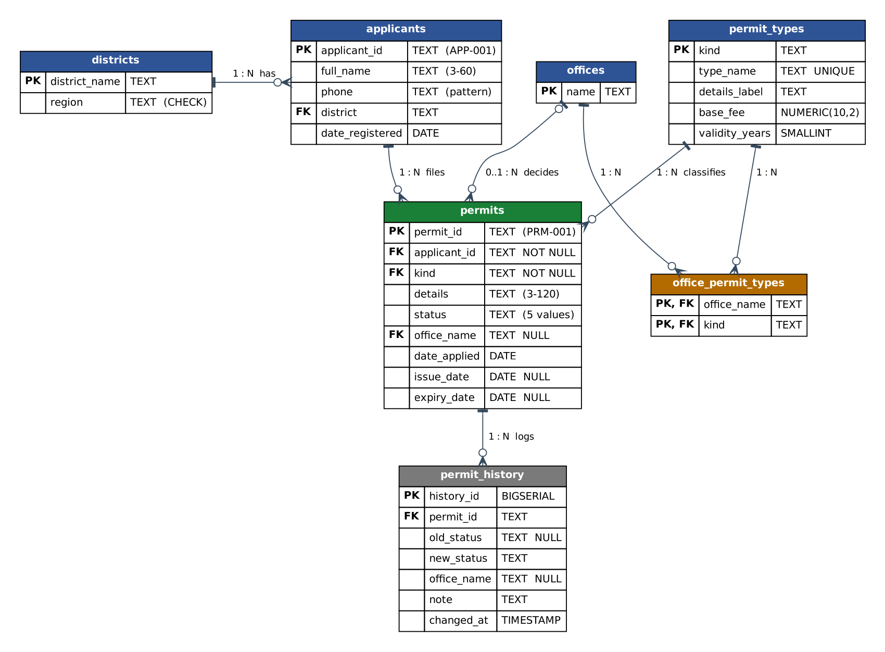

# Permit Database: PostgreSQL backend for the Digital Permit & License Management System

PROG211 OOP 1 group project, Database Systems final project (Limkokwing University
of Creative Technology, Sierra Leone). This repository holds the **complete
PostgreSQL backend** used by our Python/PyQt6 application. The application and
the database share the same project: citizens register, apply for permits, and
licensing offices review, approve, reject and renew them.



## What is in this repository

| Folder / file | Contents |
|---|---|
| `docs/physical_model.png` (and `.svg`, `.dot`) | Physical model (ER diagram) with keys, types and relationships |
| `docs/normalization.md` | How the tables were normalized to 3NF |
| `docs/presentation_guide.md` | Demo order and talking points for the presentation |
| `sql/00_create_database.sql` | Creates the `permits_db` database (run once, by hand) |
| `sql/01_tables.sql` | 7 tables, primary and foreign keys, CHECK constraints |
| `sql/02_reference_data.sql` | Districts, permit types, offices (data the app needs) |
| `sql/03_indexes.sql` | 7 indexes, including a partial index |
| `sql/04_functions_procedures.sql` | 5 functions and 2 stored procedures |
| `sql/05_triggers.sql` | 5 triggers |
| `sql/06_views.sql` | 6 views |
| `sql/07_sample_data.sql` | 12 applicants and 20 permits (fictional) |
| `queries/` | CRUD queries, 15 analysis queries, transaction demo, trigger demo |
| `tests/` | 49 automated tests (`run_tests.sql`), index demo, saved results |
| `screenshots/` | Backend and application screenshots |
| `python_integration/database.py` | The psycopg2 file that connects the PyQt6 app to this database |

## Requirements
- PostgreSQL **14 or newer** (stored procedures with OUT parameters need 14)
- `psql` command-line tool (or pgAdmin's Query Tool)

## Setup (5 minutes)
```bash
# 1. create the database (connected to the default database)
psql -U postgres -f sql/00_create_database.sql

# 2. build everything inside it, in this order
psql -U postgres -d permits_db -f sql/01_tables.sql
psql -U postgres -d permits_db -f sql/02_reference_data.sql
psql -U postgres -d permits_db -f sql/03_indexes.sql
psql -U postgres -d permits_db -f sql/04_functions_procedures.sql
psql -U postgres -d permits_db -f sql/05_triggers.sql
psql -U postgres -d permits_db -f sql/06_views.sql

# 3. load the demo data
psql -U postgres -d permits_db -f sql/07_sample_data.sql

# 4. check that everything works (changes nothing; ends with ROLLBACK)
psql -U postgres -d permits_db -f tests/run_tests.sql
```
Every script can be run again safely (`IF NOT EXISTS`, `CREATE OR REPLACE`,
`ON CONFLICT DO NOTHING`). The Python application runs scripts 01 to 06 itself
every time it starts, so a new machine only needs step 1 and `python main.py`.

## Main features

**Tables (7):** `districts`, `permit_types`, `offices`, `office_permit_types`
(many-to-many link), `applicants`, `permits`, `permit_history`. All are in 3NF.

**Constraints:** primary keys; foreign keys (`ON DELETE RESTRICT` stops deleting an
applicant who still has permits); CHECK constraints for ID format, phone pattern,
name and details length, the five valid statuses, and date logic (expiry cannot be
before issue; an approved permit must have an expiry date).

**Views (6):** `v_permit_details`, `v_status_summary`, `v_expiring_soon`,
`v_office_workload`, `v_revenue_by_type`, `v_district_report`.

**Indexes (7):** on status, applicant, kind, district, a duplicate-check index on
`(applicant_id, kind, lower(details))`, a history index, and a **partial index**
that covers only approved permits. With 40,000 test rows the expiry query ran in
about 0.3 ms with the index and 5.3 ms without it (`tests/index_explain.txt`).

**Functions and procedures:**
`fn_next_id`, `fn_permit_fee`, `fn_office_handles`, `fn_days_to_expiry`,
`fn_expire_overdue_permits`, `sp_register_applicant_and_permit` (two inserts in
one transaction), `sp_decide_permit` (review, approve, reject or renew).

**Triggers (5):**
1. only allowed status changes (Submitted to Under Review, and so on);
2. issue and expiry dates set automatically on approval;
3. an office can only handle the permit types it is responsible for;
4. no duplicate live applications;
5. every creation and change is written to `permit_history` (audit trail).

**Transactions:** `queries/10_transactions_demo.sql` shows `BEGIN`, `COMMIT`,
`ROLLBACK`, `SAVEPOINT`, and an all-or-nothing stored procedure.

## How the database supports the OOP 1 application
| Application feature | Database support |
|---|---|
| Register / edit / delete applicants | `applicants` table, constraints, `ON DELETE RESTRICT` |
| Submit, review, approve, reject, renew permits | `permits` table; triggers enforce the workflow even if another program is used |
| Reload data after restart | `SELECT` queries in `database.py`; the right Python subclass is rebuilt from the `kind` column |
| Offices that handle each permit type | `offices` + `office_permit_types` (read by `fetch_offices`) |
| Expired permits | `fn_expire_overdue_permits()` called when the app starts or refreshes |
| History button | rows in `permit_history`, written by trigger 5, read by `fetch_history` |
| Clear error messages | trigger and constraint messages are shown in the GUI warning box |

## Testing results
`tests/testing_results.txt`: **49 tests, 49 passed, 0 failed** (constraints,
triggers, functions, procedures, views, indexes). The test file runs inside one
transaction and rolls back, so it never changes your data. We also checked that
the tests really detect problems: switching off a trigger made the related tests fail.

## Privacy and Digital Public Goods
The schema stores only a name, phone number and district. There is no column for a
national ID number, address or photo. All code is open source (MIT licence).

## Team
| Name | Student ID | Role |
|---|---|---|
| [Member 1] | [ID] | [e.g. Schema and normalization] |
| [Member 2] | [ID] | [e.g. Triggers, functions and tests] |
| [Member 3] | [ID] | [e.g. Python integration and report] |

Lecturer: add as a repository collaborator.
